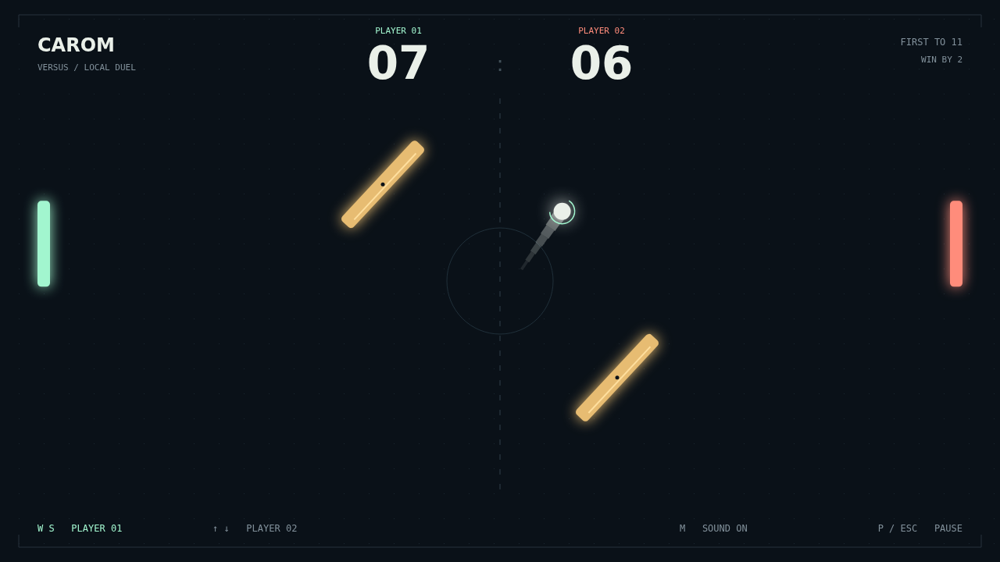

# Carom

Two paddles. One ball. A field full of possibilities. Carom is a quick,
top-down duel where a simple return can become a beautifully crooked shot.
Take on the machine in Solo or challenge a friend beside you in local Versus.

The opening serve gives you a moment to get into position. Then the rally picks
up speed with every paddle hit. Hold your ground for a clean return, or sweep
into contact to add spin and watch the ball curl away from its original line.
The glowing trail tells the story of every turn.

Two amber obstacles sway and rotate between you and the far goal. A tilted face
can turn a safe shot into a surprise, or give you exactly the bank you need.
Read the angle, commit to the hit, and make the next bounce your opponent's
problem.

First to eleven takes the match, but you need a two-point lead to finish it.
At deuce, every serve is another chance to turn a desperate save into a winner.
Stay level, find your opening, and bend the flight.

